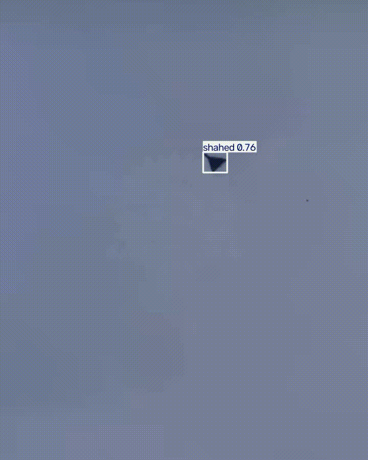
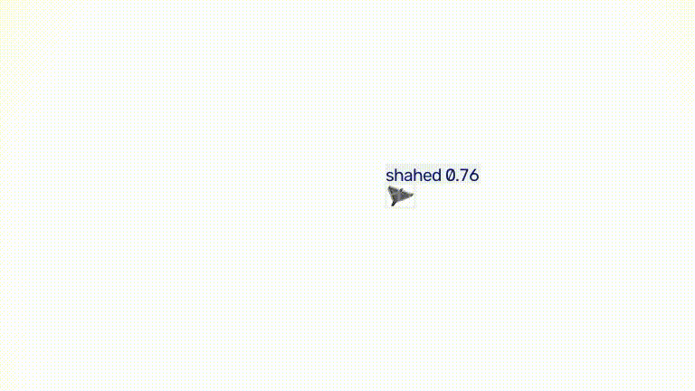
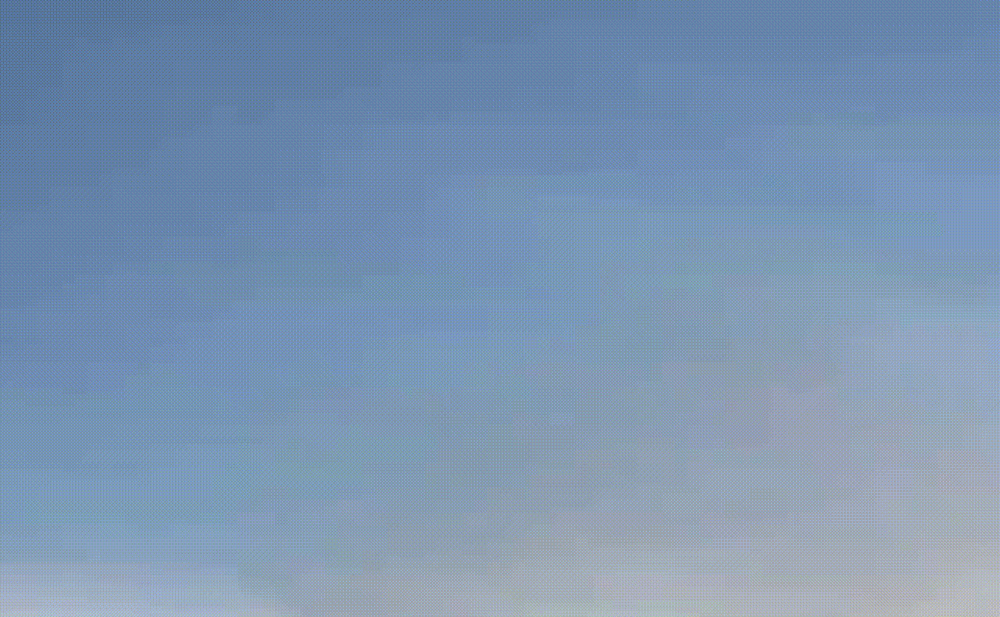
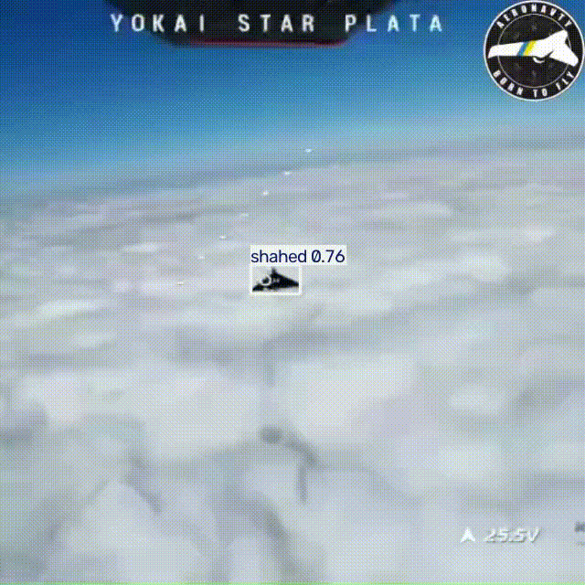
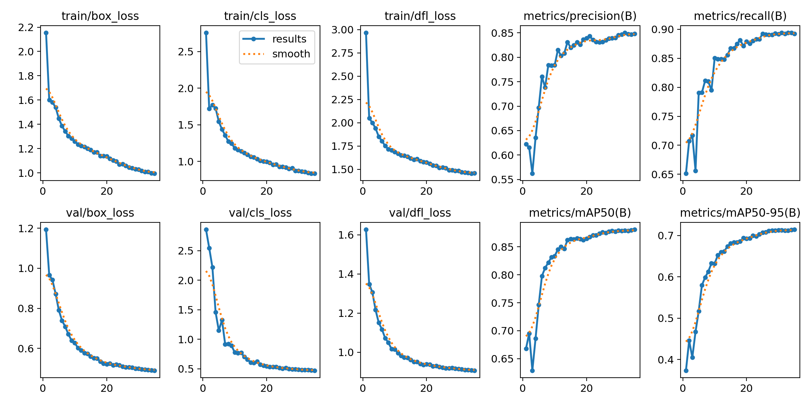

# Shahed Drone Detector (YOLOv9)

Model that detects Shahed-type drones in daytime environment; as of now, struggles with distant/low-contrast targets.

## Demo

* Daytime, distance unknown, steady handheld camera.


* Daytime, distance unknown, somewhat shaky handheld camera.


* Daytime, heavily zoomed in, shaky handheld camera.


* Daytime, interceptor drone POV, source: https://t.me/s/aeronavtyua/

## Results

* mAP50: 0.895
* mAP50-95: 0.726
* Precision: 0.842
* Recall: 0.913

* Note: After reviewing the datasets, it is quite likely that the merged dataset contains a sizable amount of 
 duplicates or near duplicates which were not filtered out before training.

* Training curve image 


## Limitations & Failure Analysis

* Model struggles with smaller targets, which is expected from a YOLO based model.
  * There were also instances where model registered targets, but mislabeled them as 
   "bird" and "not(shahed)" respectively. 
  Could be the aforementioned "small target" issue or, alternatively it is an issue with the dataset.

## Dataset
Trained on a merge of three Roboflow Universe datasets (all CC BY 4.0):
- shahed (by "e"): https://universe.roboflow.com/e-yjnj4/shahed-y4fsd — v5
- Shahed finder (by "E"): https://universe.roboflow.com/e-mjkdo/shahed-finder — v7
- shahed fix (by "myats Workspace"): https://universe.roboflow.com/myats-workspace-15deb/shahed-fix — v5

License: https://creativecommons.org/licenses/by/4.0/

- Changes: merged the three datasets, remapped classes to a `bird`, `not`, `shahed` classes. 
- The dataset is not redistributed in this repo.

* Note: After reviewing the datasets, it is quite likely that the merged dataset contains a sizable amount of 
 duplicates or near duplicates which were not filtered out before training.

## Model & Training
* For this model a modified version of `yolov9c` has been used.
* Modifications: a fourth detection head at 1/4 input resolution has been added.
* YOLO(You Only Look Once) model has been selected since it allows for fast target recognition 
  while still being compact. One big drawback is that it struggles with small target 
  which could end up being a dealbreaker when it comes to detecting drones.

- Architecture: YOLOv9c P2-head variant
- Epochs: 35
- Image size: 640
- Batch size: 4
- Optimizer: auto
- Initial learning rate: 0.01
- Seed: 0
- Training time: ~16.4 h total
- Hardware: Nvidia RTX 4060 8GB

- Weights: [best.pt (v0.1 release)](https://github.com/IllyaSkvortsov/shahed-detection-yolov9/releases/tag/0.1)
  (YOLOv9c-P2, 35 epochs, trained on the merged dataset; metrics above are for this file)
## Quickstart

```bash
pip install ultralytics
```
Put your dataset's `data.yaml` where its `train:`/`val:`/`test:` relative
paths resolve correctly (i.e. it needs to sit next to your `train/`, `valid/`,
`test/` folders), or just update the `--data` flag
to point at wherever it already lives.

## Running

- Download the weights from [best.pt (v0.1 release)](https://github.com/IllyaSkvortsov/shahed-detection-yolov9/releases/tag/0.1)

```bash
python scripts/infer_realtime.py \
  --weights <path to downloaded best.pt weights> \
  --source <path to video> \
  --show \
  --save                                                                                                                            
```
- Provide `--source 0` to run webcam instead of a video.

## Training
```bash
python scripts/train.py \
  --data /path/to/your/data.yaml \
  --model models/yolov9c-p2.yaml \
  --weights yolov9c.pt \
  --epochs 150 \
  --imgsz 640 \
  --batch 4 \
  --device 0
```
- be careful with the `--batch` param as it can be very taxing on the system. 
  I would recommend starting with `--batch 4` and later increasing it to 8 or 16.
- **Note**: training of this model has been stopped after 35 epochs,
  and it did not run for the entire 150 epochs.

## Project Structure
```
shahed-detection-yolov9/
├── assets/                       # media (demo GIFs, plots)
│   ├── clear_sky.gif
│   ├── box_size_distribution.png
│   └── class_balance.png
├── scripts/
│   ├── train.py                  # training entry point
│   ├── infer_realtime.py         # webcam / video / stream inference
│   └── inspect_dataset.py        # dataset stats, class balance, duplicate check
├── models/
│   └── yolov9c-p2.yaml           # custom architecture with P2/4 head
├── .gitignore
└── README.md
```

## Roadmap
- Improve target acquisition and recognition
- Improve small target recognition
- Experiment with modifying the dataset

## Acknowledgments & Disclaimer

### Acknowledgments
- **Datasets:** thanks to the authors of the three Roboflow Universe datasets used
  for training (CC BY 4.0, linked in the [Dataset](#dataset) section).
- **Model & framework:** Thank you [Ultralytics](https://github.com/ultralytics/ultralytics) for the
  training and inference tooling, and the authors of YOLOv9
  ([Wang, Yeh, Liao, 2024, arXiv:2402.13616](https://arxiv.org/abs/2402.13616);
  [original repo](https://github.com/WongKinYiu/yolov9)).
- **Demo footage:** clips shown in the demo come from third-party sources. All rights remain with their respective owners, and the footage is shown
  only to illustrate model behavior.

### License
- Code in this repository is released under AGPL-3.0. 
- Ultralytics is licensed under AGPL-3.0.
- Datasets keep their original CC BY 4.0 licenses.

### Disclaimer
This is a personal research and portfolio project, provided as is, without warranty
of any kind. The model has limited accuracy, especially on small, distant, or low-contrast
targets, and is not validated for any operational, safety-critical, or military use.
It is not affiliated with or endorsed by any organization.